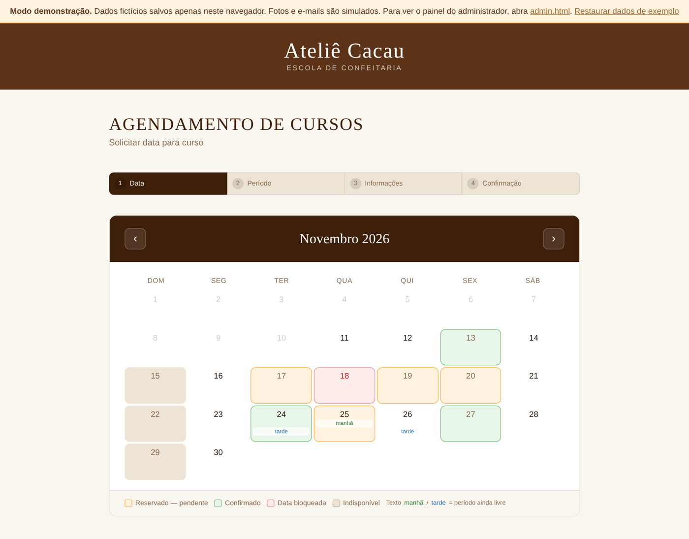
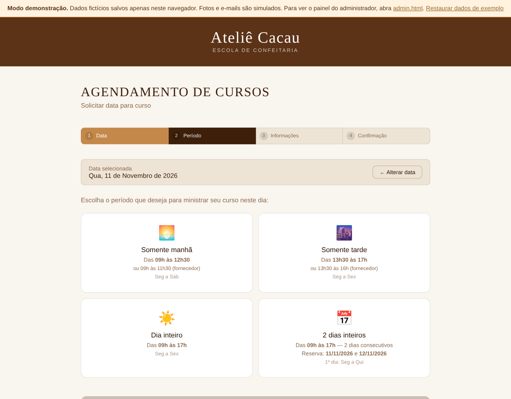
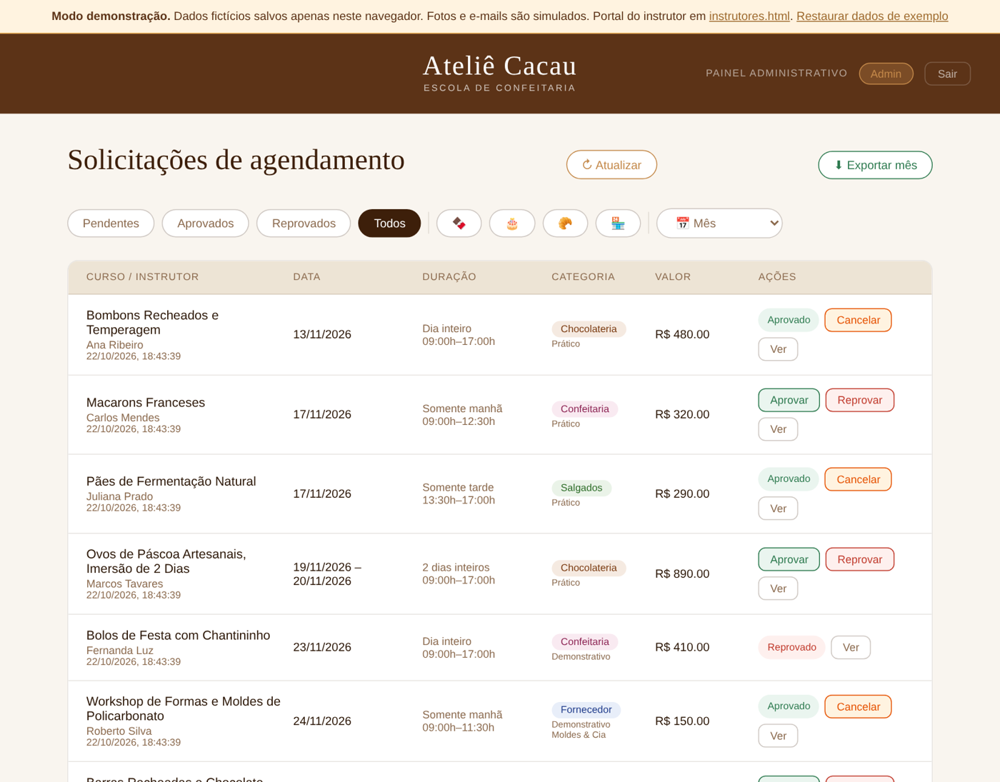
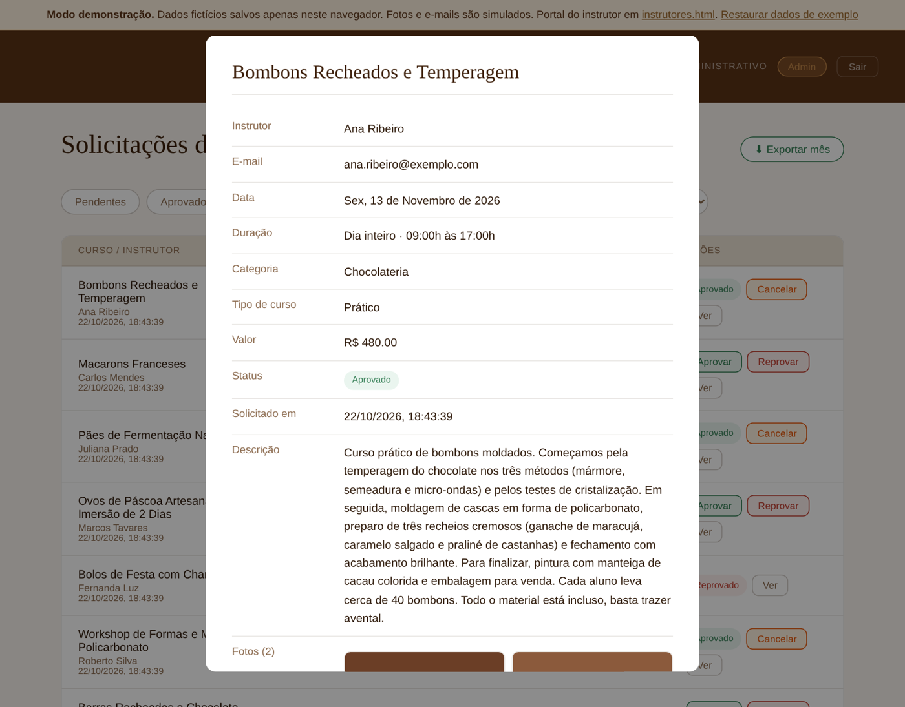

# 🗓️ Sistema de Agendamento de Cursos

> Aplicação web para que instrutores parceiros de uma escola de confeitaria solicitem datas de cursos presenciais e a equipe administrativa aprove, bloqueie datas e exporte a agenda do mês. Desenvolvida do zero para uma operação real e usada diariamente, com cerca de 40 cursos agendados por mês.

[](https://developer.mozilla.org/en-US/docs/Web/HTML)
[](https://developer.mozilla.org/en-US/docs/Web/CSS)
[](https://developer.mozilla.org/en-US/docs/Web/JavaScript)
[](https://firebase.google.com)
[](https://cloudinary.com)

---

## 🌐 Demo ao vivo

| Portal | Link |
|---|---|
| 🗓️ Portal do instrutor | [instrutores.html](https://heberthaugusto.github.io/portfolio-calendario-agendamento-cursos/instrutores.html) |
| 🔧 Painel administrativo | [admin.html](https://heberthaugusto.github.io/portfolio-calendario-agendamento-cursos/admin.html) · login `admin@demo.com` / `demo1234` |

Pode agendar, aprovar, reprovar, bloquear datas e exportar o CSV à vontade. Os dados são fictícios, ficam salvos apenas no navegador de quem acessa e podem ser restaurados pelo link no topo da página.

> ⚠️ **Esta é uma versão de demonstração, simplificada de propósito.** A aplicação em produção, usada diariamente pela escola, é mais completa e mais segura do que o que se vê aqui:
> - os dados ficam em banco de dados na nuvem (Firebase Firestore), compartilhados em tempo real entre instrutores e equipe, não no navegador;
> - o acesso ao painel administrativo é feito por autenticação real (Firebase Authentication), com senha gerenciada pela equipe, não por uma credencial fixa;
> - as fotos são enviadas para um serviço de armazenamento de imagens (Cloudinary), com validação, tentativas automáticas e expiração;
> - os e-mails de notificação, aprovação e reprovação são realmente disparados (EmailJS), com templates próprios;
> - as chaves de API são restritas ao domínio de produção e as regras do banco limitam quem pode gravar o quê.
>
> Nesta demo tudo isso foi substituído por um armazenamento local (`demo-store.js`), fotos reduzidas no próprio navegador e avisos simulados na tela, para que qualquer pessoa consiga testar o fluxo completo sem credenciais. A lógica das telas e as regras de negócio são as mesmas da produção. A marca exibida (Ateliê Cacau) é fictícia.

---

## 🎯 Sobre o projeto

Antes do sistema, os instrutores pediam datas por WhatsApp e telefone e a equipe controlava tudo em planilha, com conflitos de agenda e retrabalho. O sistema substituiu esse fluxo por dois portais:

- um **calendário interativo** em que o instrutor escolhe data e período, descreve o curso e envia fotos;
- um **painel administrativo** em que a equipe aprova ou reprova, bloqueia datas e exporta a agenda do mês.

As regras de negócio (prazo mínimo e máximo, limite mensal, períodos permitidos por dia da semana, bloqueio por período, motivo de reprovação, horário de fornecedor) foram incorporadas ao longo do uso, a partir dos pedidos dos próprios usuários.

---

## ✨ Funcionalidades

### 🗓️ Portal do instrutor
- Calendário com disponibilidade em tempo real
- Fluxo guiado em 4 etapas: data → período → informações → confirmação
- Regras de negócio automáticas:
  - prazo mínimo de 20 dias e janela máxima até o fim do mês seguinte (ambos com liberação excepcional pelo admin)
  - limite de 5 cursos por instrutor por mês
  - segundas-feiras de manhã bloqueadas (reservadas para lives), liberáveis pelo admin
  - dias da semana permitidos por período (manhã, tarde, dia inteiro, 2 dias)
  - horário reduzido para cursos de fornecedor (09h às 11h30 e 13h30 às 16h)
- Tipo de curso (prático ou demonstrativo) e nome do fornecedor quando for o caso
- Indicação visual de status por cor: 🟠 pendente · 🟢 confirmado · 🔴 bloqueado, com período livre indicado no dia
- Upload de 2 a 5 fotos com validação de resolução mínima (1080×1080 px) e detecção de foto duplicada
- Validação completa do formulário, com contador de caracteres (mín. 500)
- Releitura da disponibilidade antes de gravar, para evitar que duas pessoas reservem o mesmo período
- Notificação por e-mail ao administrador a cada solicitação

### 🔧 Painel administrativo
- Autenticação por e-mail e senha
- Aprovação e reprovação com e-mail automático para o instrutor, com motivo da reprovação registrado e enviado
- Cancelamento de aprovação com liberação imediata da data
- Filtros por status, categoria e mês
- Exportação em **CSV** dos cursos aprovados do mês (com total)
- Galeria de fotos com download individual ou em lote
- Bloqueio de dia inteiro ou só de um período (manhã ou tarde) para feriados, eventos e manutenção
- Liberação de datas dentro do prazo mínimo e de segundas-feiras
- Calendário com a mesma leitura visual do portal do instrutor

---

## 🏗️ Arquitetura

| Camada | Produção | Demo (este repositório) |
|---|---|---|
| Front-end | HTML, CSS e JavaScript puro (ES Modules) | igual |
| Banco de dados | Firebase Firestore (3 coleções) | `demo-store.js` em localStorage |
| Autenticação | Firebase Authentication | credencial fixa validada localmente |
| Fotos | Cloudinary, upload sem assinatura, com timeout e até 3 tentativas | imagem reduzida e guardada localmente |
| E-mail | EmailJS, 2 templates | aviso simulado na tela |
| Hospedagem | GitHub Pages | GitHub Pages |

### Decisões técnicas

| Decisão | Justificativa |
|---|---|
| **JavaScript puro, sem framework** | Escopo definido, sem reatividade complexa. Menor peso e manutenção simples. |
| **Firestore** | Banco em tempo real sem back-end próprio. Gratuito para o volume de uso. |
| **Firebase Authentication** | Protege o painel admin sem implementar autenticação própria. |
| **Cloudinary** | Upload direto do navegador, com URL pública e expiração automática das fotos. |
| **EmailJS** | E-mails transacionais a partir do front-end, sem servidor. |
| **Camada de dados isolada** | As chamadas ao Firestore ficam concentradas em poucas funções, o que permitiu trocar por `demo-store.js` sem alterar a lógica das telas. |

### Segurança (produção)
- Aprovações, bloqueios e liberações só podem ser gravados por usuário autenticado
- Chaves de API restritas ao domínio de produção
- Upload de fotos restrito por tipo de arquivo, pasta e domínio
- Nenhum segredo no front-end, apenas chaves públicas

---

## 📐 Regras de negócio

```
Manhã:           09h às 12h30  |  Terça a Sábado
Tarde:           13h30 às 17h  |  Segunda a Sexta
Dia inteiro:     09h às 17h    |  Segunda a Sexta
2 dias seguidos: 09h às 17h    |  1º dia: Segunda a Quinta

Prazo mínimo:    20 dias de antecedência (liberável pelo admin)
Prazo máximo:    até o fim do mês seguinte
Fornecedor:      09h às 11h30 (manhã) · 13h30 às 16h (tarde)
Limite mensal:   5 cursos por instrutor
Aprovação:       até 5 dias úteis
Fotos:           2 a 5 · JPG ou PNG · mín. 1080×1080 px
```

---

## ⚙️ Como rodar

Basta abrir `instrutores.html` ou `admin.html` em um servidor estático (GitHub Pages, `python -m http.server`, extensão Live Server). Não há nada para configurar.

Os pontos do código onde a produção usa Firebase, Cloudinary e EmailJS estão comentados com "Produção:", para quem quiser ver como a demo se encaixa na arquitetura real.

---

## 📁 Estrutura

```
├── instrutores.html     Portal de agendamento para instrutores
├── admin.html           Painel administrativo
├── demo-store.js        Camada de dados do modo demonstração
├── screenshot-*.png     Capturas de tela
└── README.md
```

---

## 📸 Screenshots

### Calendário do instrutor


### Seleção de período


### Painel administrativo


### Detalhes da solicitação


---
> ⚖️ **Uso do código.** Este repositório é disponibilizado apenas para fins de portfólio e avaliação profissional. Todos os direitos reservados. Não é permitido copiar, modificar, distribuir ou usar o código, no todo ou em parte, para qualquer finalidade, sem autorização por escrito.
---

## 👤 Autor

**Heberth Augusto**

[](https://www.linkedin.com/in/heberth-augusto-ti/)
[](https://github.com/heberthaugusto)

*Desenvolvido com IA generativa (Claude) como ferramenta de trabalho, com revisão de código e testes em homologação antes de produção.*
